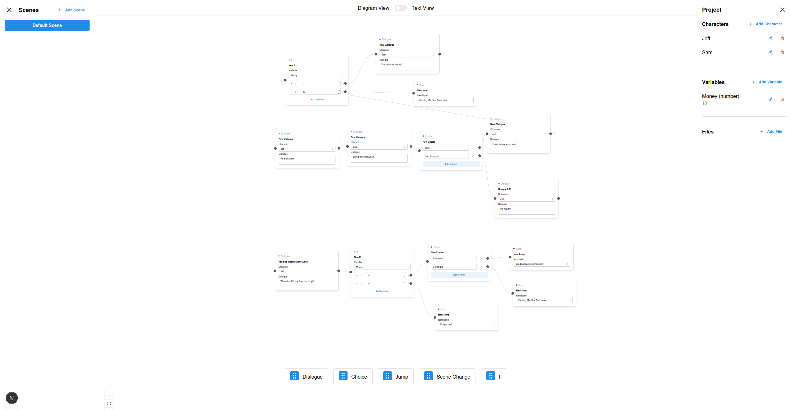
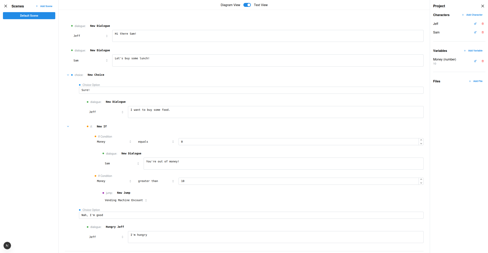

# Dialogue Tree Editor

Design branching dialogue and event logic visually or in plain text.
Switch between Diagram Mode for intuitive node editing and Text Mode for fast keyboard-based writing,
then read the story in Play Mode.

**Stories from AI:** open Import, copy the format instructions into any AI chat, describe the story,
and paste the reply back. Imported stories are laid out automatically (the tree button in the
diagram controls re-runs the layout). Export saves the project as the same JSON format.

## Diagram Mode


## Text Mode


## Development

```sh
pnpm install
pnpm dev     # http://localhost:3000
pnpm test    # prettier, eslint, stylelint, tsc
```

Projects are saved in the browser's localStorage. Pushing to the `deploy` branch publishes to GitHub Pages.
